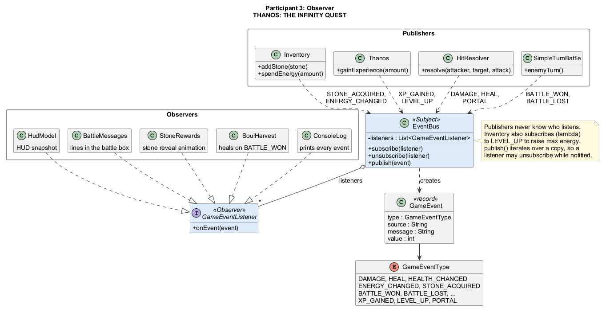
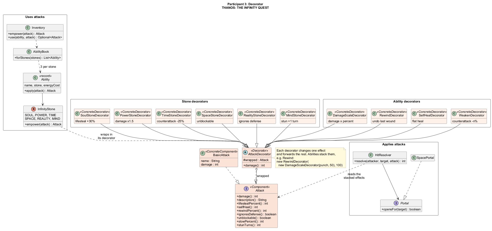
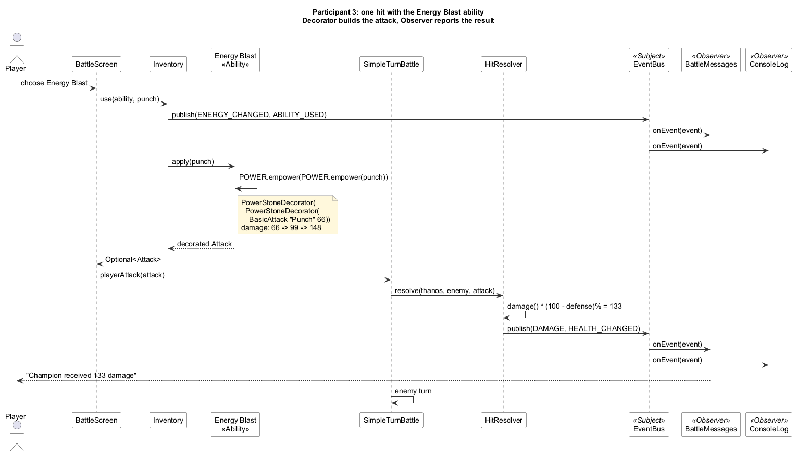
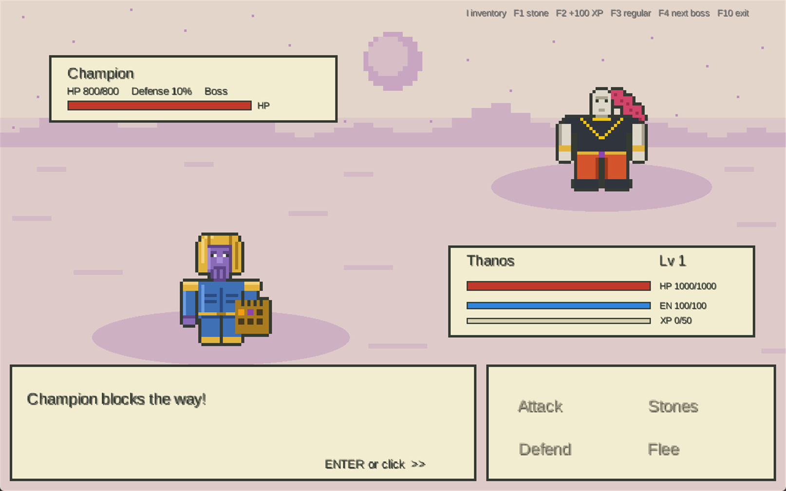
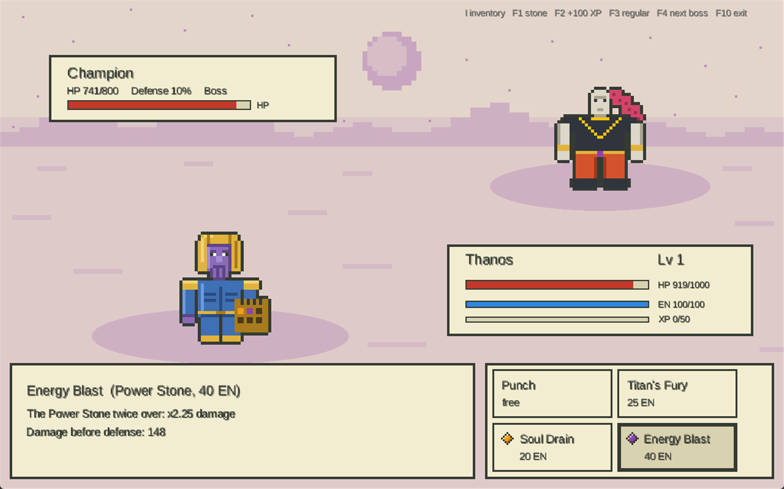
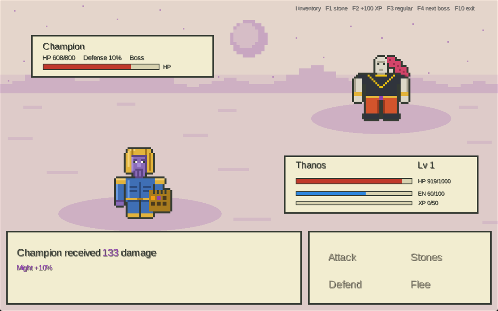
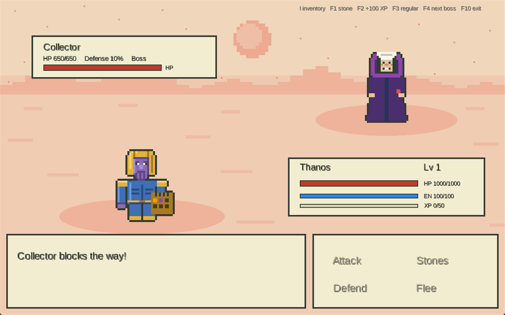

# Participant 3: Observer and Decorator

Report section for the final project *THANOS: THE INFINITY QUEST*.
Participant 3 is responsible for gameplay: the Infinity Stones, the inventory, Thanos's abilities and progress,
the HUD and the turn-based battle screen. Two design patterns hold this part together:

- **Observer**: game logic announces what happened, and the UI and other systems react without being called directly.
- **Decorator**: an attack is built at runtime by wrapping a basic hit in stone and ability effects.

All code is in the `participant3` Maven module, package `com.thanos.participant3`.

## 1. Observer

### Problem

One hit in battle changes many things at once:

- the enemy health bar;
- the message box text;
- the console log;
- sometimes Thanos's health (lifesteal);
- the stone reward animation after a win.

If the battle code called every one of these directly, it would depend on the UI. Every new screen would mean
editing the battle code, and the battle could not run in a test without a window.

### Solution

The battle logic only **publishes** events to an `EventBus`. Anything that wants to react **subscribes** to the bus.
Publishers never know who listens, and the game works the same with zero subscribers.

| Role | Class |
|---|---|
| Subject | `patterns.observer.EventBus` |
| Observer interface | `patterns.observer.GameEventListener` |
| Event | `patterns.observer.GameEvent` (record), `GameEventType` (16 types) |
| Publishers | `HitResolver`, `SimpleTurnBattle`, `Inventory`, `Thanos`, `SoulHarvest` |
| Concrete observers | `BattleMessages`, `HudModel`, `StoneRewards`, `SoulHarvest`, `ConsoleLog` |

The subject keeps a list of listeners and notifies them in order. It iterates over a copy, so a listener
may unsubscribe while it is being notified:

```java
public final class EventBus {
    private final List<GameEventListener> listeners = new ArrayList<>();

    public void subscribe(GameEventListener listener) {
        if (listener == null) {
            throw new IllegalArgumentException("Listener must not be null");
        }
        if (!listeners.contains(listener)) listeners.add(listener);
    }

    public void unsubscribe(GameEventListener listener) {
        listeners.remove(listener);
    }

    public void publish(GameEvent event) {
        // Copy so a listener may unsubscribe while being notified.
        for (GameEventListener listener : List.copyOf(listeners)) {
            listener.onEvent(event);
        }
    }
}
```

An event is an immutable record:

```java
public record GameEvent(GameEventType type, String source, String message, int value) { }
```

A publisher only describes what happened. For example, `HitResolver` after a hit:

```java
target.takeDamage(dealt);
events.publish(GameEventType.DAMAGE, target.name(), target.name() + " received " + dealt + " damage", dealt);
publishHealth(target);
```

The simplest observer prints every event:

```java
public final class ConsoleLog implements GameEventListener {
    public void onEvent(GameEvent event) {
        System.out.println("[" + event.type() + "] " + event.message());
    }
}
```

Other observers react to specific events:

- **`BattleMessages`** turns events into lines in the battle message box.
- **`HudModel`** keeps the numbers for the health, energy and XP bars.
- **`StoneRewards`** starts the stone animation on `STONE_ACQUIRED`.
- **`SoulHarvest`** heals Thanos on `BATTLE_WON` if he owns the Soul Stone.

`SoulHarvest` is both an observer and a publisher. `Inventory` subscribes with a lambda to `LEVEL_UP` to raise
the maximum energy.

The demo wires everything in one place:

```java
events.subscribe(messages);
events.subscribe(new ConsoleLog());
events.subscribe(rewards);
events.subscribe(new SoulHarvest(thanos, inventory, events));
```

### UML



### Result

- `SimpleTurnBattle` and `HitResolver` have no UI code and no `System.out`. All output goes through observers.
- A new reaction (sound, achievements, statistics) is a new listener; existing classes stay unchanged (Open/Closed).
- The battle is tested without any window: `EventBusTest.battleLogicKeepsWorkingWithoutSubscribers`.

## 2. Decorator

### Problem

Each of the six stones changes an attack in its own way:

| Stone | Effect |
|---|---|
| Soul | lifesteal |
| Power | more damage |
| Time | weaker counterattack |
| Space | unblockable: ignores defense |
| Reality | defense becomes extra damage |
| Mind | stun |

Thanos has eight skills: two base ones (*Punch*, *Titan's Fury*) and one per stone. Every new stone unlocks its
skill; the sixth stone completes the gauntlet and upgrades all eight at once. Skills
combine effects: *Rewind* deals half damage and undoes the enemy's last blow, and its upgrade *Time Loop* also
weakens the enemy's next hit. A subclass for every combination (`PowerSoulAttack`, `PowerPowerAttack`, ...) would
explode in number and could not be built at runtime.

### Solution

`Attack` is a small interface. A basic hit is the concrete component. Every effect is a decorator that wraps another
`Attack`, changes one thing and forwards everything else. Effects stack in any order and depth at runtime.

| Role | Class |
|---|---|
| Component | `patterns.decorator.Attack` |
| Concrete component | `BasicAttack` |
| Base decorator | `AttackDecorator` |
| Stone decorators | `SoulStoneDecorator`, `PowerStoneDecorator`, `TimeStoneDecorator`, `SpaceStoneDecorator`, `RealityStoneDecorator`, `MindStoneDecorator` |
| Ability decorators | `DamageScaleDecorator`, `RewindDecorator`, `SelfHealDecorator`, `WeakenDecorator` |
| Client | `HitResolver` reads the stacked effects and applies the hit |

```java
public interface Attack {
    int damage();
    String description();

    default int lifestealPercent() { return 0; }
    default boolean ignoresDefense() { return false; }
    default int stunTurns() { return 0; }
    // ... selfHeal, rewindPercent, unblockable, turnsDefenseIntoDamage, slowPercent
}
```

The base decorator forwards every call to the wrapped attack:

```java
public abstract class AttackDecorator implements Attack {
    protected final Attack wrapped;

    protected AttackDecorator(Attack wrapped) {
        if (wrapped == null) {
            throw new IllegalArgumentException("Decorator needs an attack to wrap");
        }
        this.wrapped = wrapped;
    }

    public int damage() { return wrapped.damage(); }
    public String description() { return wrapped.description(); }
    public int lifestealPercent() { return wrapped.lifestealPercent(); }
    // ... the other effects are forwarded the same way
}
```

A concrete decorator overrides only its own effect:

```java
public final class PowerStoneDecorator extends AttackDecorator {
    public PowerStoneDecorator(Attack wrapped) { super(wrapped); }

    public int damage() { return wrapped.damage() * 3 / 2; }
    public String description() { return wrapped.description() + " + Power Stone (x1.5 damage)"; }
}
```

Each stone knows its decorator (`InfinityStone.empower`). An ability is a function that stacks decorators, so all
16 forms of the eight skills are built from 10 decorator classes. An upgrade is simply one more layer:

```java
new Ability("Energy Blast", POWER, 40, "The Power Stone twice over: x2.25 damage",
        attack -> POWER.empower(POWER.empower(attack)));

new Ability("Rewind", TIME, 35, "Undoes the enemy's last blow, strikes at half strength",
        AbilityBook::rewind);
new Ability("Time Loop", TIME, 35, "Rewind, and the enemy's next hit is 25% weaker",
        attack -> TIME.empower(rewind(attack)));
```

### UML



### Result

- A new stone effect or ability is one small class or one line in `AbilityBook`. No existing class changes.
- Effects combine freely. The test `AttackDecoratorTest.stonesStackWithoutAClassPerCombination` checks this.
- `HitResolver` does not care how many layers an attack has; it only asks the final object.
- The same questions describe enemy attacks. With the Mind Stone the battle shows *Foresight*: `TurnBattle.nextEnemyAttack`
  returns the blow the enemy is about to make, and `EnemyIntent` reads its name, damage and effects (stun, weakening,
  ignores defense, lifesteal) straight from the decorated `Attack`.

## 3. How the two patterns work together

The Decorator builds the attack, and the Observer reports what it did. The diagram shows one turn with the
*Energy Blast* ability:

1. The Power Stone decorates the punch twice (66 → 99 → 148).
2. `HitResolver` lets the defense block its percent of the damage (10%) and applies 133 damage.
3. The result goes to every observer through the `EventBus`.



Console output of the same turn, printed by the `ConsoleLog` observer:

```
[ENERGY_CHANGED] Thanos energy: 60/100
[ABILITY_USED] Thanos used Energy Blast (Power Stone)
[DAMAGE] Champion received 133 damage
[HEALTH_CHANGED] Champion health: 608/800
[DAMAGE] Thanos received 81 damage
[HEALTH_CHANGED] Thanos health: 838/1000
```

The battle works with fighters only through the `Combatant` interface, so it does not depend on where they come
from. The standalone battle demo of this module (`run-battle-demo.bat`) uses simple local stats for the enemies.

## 4. Screenshots

Battle with the Champion (the backdrop is tinted by the world's stone; the enemy box shows HP, defense and boss status):



Choosing an ability in the 2x2 menu (a small gem marks stone skills); the description and energy cost come from the decorated ability:



The result of Energy Blast: 133 damage instead of 59 for a plain punch; the Power Stone passive highlights the number ("Might +10%"):



Another world (Collector, Reality Stone):



## 5. Testing

The module has 72 JUnit 5 tests, and all of them pass (`mvn -f participant3/pom.xml package`).

**Observer, `EventBusTest`:**
- every subscriber gets the damage event;
- the battle works without subscribers;
- subscribing twice delivers once;
- a listener may unsubscribe while being notified;
- a defeat is announced.

**Decorator, `AttackDecoratorTest`:**
- the Power Stone raises damage and extends the description;
- stones stack without a class per combination;
- decorators keep the other effects of the wrapped attack;
- defense blocks a plain hit, the Space Stone ignores it, the Reality Stone turns it into damage;
- the Soul Stone heals the attacker;
- a decorator needs something to wrap.

**Gameplay built on them:**
- `AbilityBookTest`, `InventoryTest` and `StonePassivesTest` cover stones, abilities and energy;
- `SimpleTurnBattleTest` covers the battle;
- `SpacePortalTest` covers the portal;
- `ThanosTest` covers levels and XP;
- `StoneRewardsTest` and `HudModelTest` are observers tested through events.

## 6. Conclusion and further work

Observer keeps the game logic independent of the screen: the same battle drives the libGDX battle screen,
the HUD and the console log. Decorator turns six stones and eight upgradable skills into ten small classes that combine at
runtime. Together they let a new stone effect or a new screen be added without touching the battle code.

Further work:

- Connect the battle to the other modules through an adapter from participant 2's `Enemy` to `Combatant`.
  - Enemies would come from participant 2's **Factory Method** (`BasicEnemyFactory`, `BossEnemyFactory`).
  - Their damage would be computed by participant 2's **Strategy** and applied through the same `HitResolver`.
  - Battles would start from participant 1's game loop (**Facade**) in the worlds built by participant 1's **Builder**.
- Remove a listener automatically when a screen closes (an `unsubscribe` on dispose).
- Typed events (one record per event type) instead of one generic `GameEvent`, so a listener cannot misread `value`.
- Sound effects and achievements as new observers.
- Let enemies use decorated attacks too, so bosses can have their own stone effects.
